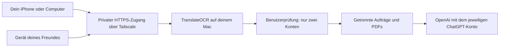

# TranslateOCR – private Online-Webapp für zwei Personen

Stand: 22. Oktober 2026. Konzept für die nächste Umsetzung; der Fernzugriff und die zweite Person sind noch nicht eingerichtet.

## Empfehlung

Den vorhandenen Mac als TranslateOCR-Server weiterverwenden und die Anwendung über **Tailscale Serve** privat per HTTPS erreichbar machen. Du und dein Freund verwendet jeweils eine eigene freigegebene Identität und eine eigene ChatGPT-Verbindung. Am iPhone lässt sich die Website zum Home-Bildschirm hinzufügen.

Das ergibt bei privater, nicht kommerzieller Nutzung **0 € zusätzliche Hostinggebühren**, sofern der vorhandene Mac läuft. Strom, Internet und die jeweiligen ChatGPT-Abos bleiben eigene Kosten. Der Mac muss eingeschaltet, mit dem Internet verbunden und für den Dienst wach bleiben. Bei ausgeschaltetem Mac ist die Webapp nicht erreichbar.

Tailscale Personal ist aktuell kostenlos für bis zu sechs Personen. Serve stellt einen lokalen Dienst innerhalb dieses privaten Netzes bereit und unterstützt HTTPS sowie Zugriffsregeln. Die Verbindung am iPhone erfordert die Tailscale-App. Das ist somit eine über das Internet nutzbare private Website mit zusätzlicher Geräteverbindung. [Preise](https://tailscale.com/pricing), [Serve](https://tailscale.com/docs/features/tailscale-serve), [iOS-App](https://tailscale.com/download/ios).

## ChatGPT-Anmeldung: zuerst die Machbarkeit prüfen

Die Freigabe der Website und die Freigabe eines ChatGPT-Plans sind zwei getrennte Dinge. Die Website lässt nur zwei vorab bestimmte Benutzer zu. Jeder verbindet anschließend sein eigenes berechtigtes ChatGPT-Konto; Aufträge dürfen niemals automatisch auf das Konto der anderen Person ausweichen.

OpenAI unterscheidet Website-Anmeldung und Plan-Nutzung. Für die Plan-Nutzung sind zusätzliche Berechtigungen nötig; die Verfügbarkeit hängt von Konto und Client ab. Eine erfolgreiche Anmeldung allein garantiert keine Modellnutzung. Ein kostenloses ChatGPT-Konto ist damit keine zugesicherte Grundlage. [OpenAI Quickstart](https://developers.openai.com/siwc/quickstart).

Der bisher eingebaute dynamische Client verwendet einen Rückruf an `127.0.0.1`. Auf dem iPhone würde dieser Rückruf zum iPhone gehen. Die vorhandene Anmeldung lässt sich deshalb nicht einfach auf eine entfernte HTTPS-Adresse umstellen. [Registrierung und Anmeldung](https://developers.openai.com/siwc/token-sharing-open-source/sign-in).

OpenAI beschreibt für entfernte selbst gehostete Installationen eine lokale Autorisierung und anschließende geschützte Übertragung der ausgewählten Verbindung auf den Server. Diesen Ansatz prüfen wir für jeden Benutzer getrennt, einschließlich Server-Host-ID und späterer Token-Erneuerung. Ein kleiner lokaler Verknüpfungshelfer kann den Vorgang vereinfachen. Keine Tokens per Nachricht, Zwischenablage oder ungeschütztem Upload austauschen. Eine erneute Computer-Verknüpfung kann bei abgelaufener oder widerrufener Freigabe notwendig werden. [Self-hosted VMs](https://developers.openai.com/siwc/token-sharing-open-source/self-hosted-vms).

**Offen und zuerst zu testen:** Funktioniert diese getrennte Verknüpfung mit euren beiden Konten im vorgesehenen Betrieb? Eine erstmalige Freigabe ausschließlich am iPhone wird mit dem aktuellen Verfahren nicht zugesagt. Falls genau das zwingend ist, müssen wir zuerst einen dafür geeigneten, freigegebenen Website-Client klären. Hosting allein löst diese Frage nicht.

## Technischer Aufbau

Die bestehende Online-Oberfläche allein führt derzeit keine entfernten Übersetzungen aus. Für das Ziel muss der gesamte Dienst erreichbar sein: Upload, Office-Konvertierung, Übersetzung, Warteschlange und PDF-Erzeugung. Ein reines Frontend-Deployment bei Vercel würde diesen Umbau nicht ersetzen.

Vor der Freigabe wird die bisher persönliche Backend-Verbindung auf getrennte Benutzerverbindungen umgestellt. Jeder sieht ausschließlich seine Aufträge, Dateien, Ergebnisse und Verbindung. Jede API-Route prüft diese Zuordnung serverseitig. Abmelden oder Trennen betrifft nur das eigene Konto. Gleichzeitige Aufträge werden fair abgearbeitet; ein Kontolimit blockiert nicht den anderen Benutzer.

Der Dienst bleibt an Loopback gebunden. Nur der vorgesehene lokale Proxy darf Identitätsinformationen liefern. Die Anwendung akzeptiert genau die beiden konfigurierten Identitäten; zusätzlich beschränken Netzwerkregeln den Zugriff auf den TranslateOCR-Dienst. Keine allgemeine Registrierung. Diese Proxy-Auswertung und ihre Bindung müssen ausdrücklich getestet werden. Tailscale dokumentiert hierfür Identitätsheader und empfiehlt die lokale Bindung. [Serve-Identität](https://tailscale.com/docs/features/tailscale-serve#identity-headers).

Dokumente und PDFs bleiben kurzlebig. Zugangsdaten werden ausschließlich geschützt auf dem Server gespeichert. Der Browser-Cache und ein möglicher Service Worker speichern keine Dokumente, API-Antworten oder Tokens. Der Administrator des Macs hat technisch Zugriff auf die Serverdaten; die Trennung schützt die Benutzer innerhalb der Anwendung.

## iPhone-Webapp

TranslateOCR bekommt App-Icon, Manifest, passende Darstellung im eigenständigen Fenster und ein mobiles Layout. Uploads aus Dateien und Fotos sowie der PDF-Download werden auf dem iPhone geprüft. Lange Übersetzungen laufen auf dem Mac weiter, wenn Safari in den Hintergrund geht. Nach dem Öffnen zeigt die App den aktuellen Auftragsstand. Die Übersetzung benötigt eine Internetverbindung; die Installation macht sie nicht offlinefähig.

Installation: In Safari öffnen, Teilen → „Zum Home-Bildschirm“ → als Webapp öffnen. [Apple-Anleitung](https://support.apple.com/de-de/guide/iphone/iphea86e5236/ios).

## Umsetzung als nächste Aufgabe

| Schritt | Ergebnis | Geschätzte aktive Arbeitszeit |
| --- | --- | --- |
| 1. ChatGPT-Fernverknüpfung prüfen | Getrennte Anmeldung, Testanfrage und Token-Erneuerung; Entscheidung über den tragfähigen Ablauf | 30–60 Minuten |
| 2. Benutzertrennung bauen | Zwei erlaubte Identitäten, eigene Verbindungen, Aufträge und Downloads | 60–120 Minuten |
| 3. Privaten Zugriff einrichten | Tailscale, HTTPS, eingeschränkte Regeln und verlässlicher Dienststart | 30–60 Minuten |
| 4. iPhone-Webapp fertigstellen | Icon, Installation, Upload, Hintergrundbetrieb und PDF-Download | 30–60 Minuten |
| 5. Ende-zu-Ende prüfen | Beide Konten funktionieren; fremde Benutzer und fremde Auftrags-IDs werden abgewiesen | 30–60 Minuten |

Gesamtschätzung: **3–6 Stunden**, zuzüglich eurer Anmeldungen und möglicher externer Freischaltungen. Die erste Prüfung entscheidet, ob der ChatGPT-Ablauf ohne weiteren Anbieterzugang umsetzbar ist.

## Was ihr selbst machen müsst

1. Je ein eigenes Tailscale-Konto anmelden und die App auf den verwendeten Geräten aktivieren. Der Freund nimmt die private Einladung selbst an.
2. Die beiden erlaubten Anmelde-Identitäten angeben. Nur diese werden konfiguriert.
3. Jeder autorisiert sein ChatGPT-Konto persönlich; beim empfohlenen Verfahren zunächst an einem Computer. Passwörter werden nicht weitergegeben.
4. Den Server-Mac während der gewünschten Nutzungszeiten eingeschaltet lassen und gegebenenfalls macOS-Systemfreigaben bestätigen.
5. Die Website am iPhone zum Home-Bildschirm hinzufügen und einen Testupload durchführen.

Wenn die Website ohne zusätzliche Tailscale-App oder unabhängig von deinem Mac laufen soll, braucht das eine andere Hosting- und Zugangslösung. Diese Variante muss gesondert auf laufende Kosten und den ChatGPT-Anmeldeweg geprüft werden; sie ist hier nicht als kostenloser Dauerbetrieb zugesagt.
