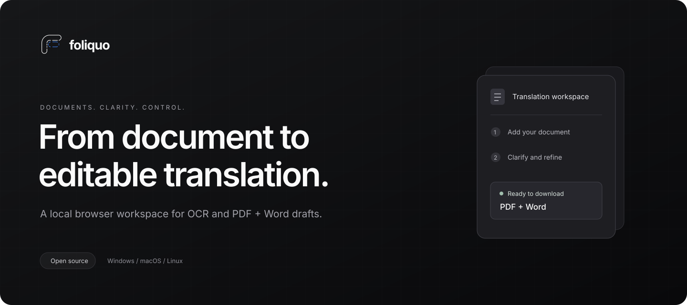
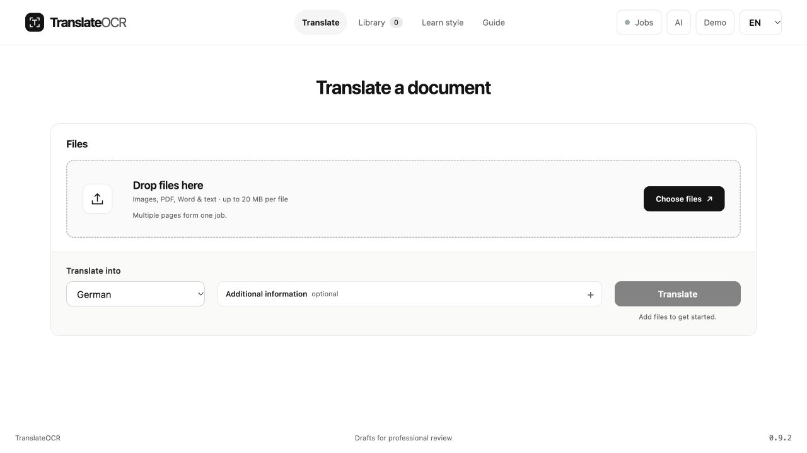

<p align="center">
  <a href="https://maximilianauer.at/projects/translateocr/demo/?lang=en">
    
  </a>
</p>

<p align="center">
  <strong>From document to editable translation.</strong><br>
  An open-source, browser-based workspace for OCR, clarifications and PDF + Word drafts.<br>
  Runs on your computer. Opens in your browser.
</p>

<p align="center">
  <a href="https://maximilianauer.at/projects/translateocr/demo/?lang=en"><strong>Try the demo</strong></a> ·
  <a href="https://github.com/gitmaximilian/TranslateOCR/archive/refs/heads/main.zip"><strong>Download</strong></a> ·
  <a href="docs/BROWSER-SETUP.md">Setup guide</a> ·
  <a href="https://maximilianauer.at/projects/translateocr/">Project story</a>
</p>

<p align="center">
  <a href="https://github.com/gitmaximilian/TranslateOCR/actions/workflows/ci.yml"></a>
  <a href="LICENSE"></a>
  
</p>

## See the workflow

[](https://maximilianauer.at/projects/translateocr/demo/?lang=en)

**Upload → clarify → refine → download.** Combine the front and back of a document, confirm an uncertain reading, then export PDF and editable Word. Optional review tools stay out of the way until you need them.

The [interactive demo](https://maximilianauer.at/projects/translateocr/demo/?lang=en) walks through all four steps with a fictional driving licence. No account, installation or model request is needed. It includes downloadable PDF and Word examples, and supports English, German and Arabic.

## Made for document work

| One coherent workflow | What it does |
| --- | --- |
| **Add every page** | Images, PDFs and Word files can be grouped into one job. Source language and document type are detected automatically. |
| **Resolve uncertainty** | Accept a suggested spelling, answer a question, or explicitly mark a field unreadable. View the highlighted original with zoom and pan. |
| **Keep moving** | A job queue shows progress and requests for answers. Partial answers and revisions stay saved locally. |
| **Make it your own** | Upload finished translation examples to reuse layout and wording conventions. This supplies reference rules; it does not train model weights. |
| **Refine the result** | Compare original and translation, make direct edits or request changes in a revision chat. Download PDF and Word directly. |
| **Choose your provider** | ChatGPT account authorization, or separately billed OpenAI, Claude and DeepSeek APIs. Connect during onboarding or from the header. |

<details>
<summary><strong>A closer look at source review</strong></summary>


Wheel or trackpad zoom, drag-to-pan, fit-to-view, keyboard controls and a larger view keep small print accessible. The highlight scales with the image, and the view survives unchanged job polling.

</details>

## Download and start

1. Download and extract the [latest source ZIP](https://github.com/gitmaximilian/TranslateOCR/archive/refs/heads/main.zip).
2. Open the extracted folder and double-click the setup file for your computer: `Setup-TranslateOCR.cmd` on Windows, `Setup-TranslateOCR.command` on macOS, or `Setup-TranslateOCR.sh` on Linux.
3. Follow any system permission prompt. Setup prepares the required tools, checks PDF and Word export, then opens TranslateOCR in your browser.
4. Leave the small TranslateOCR window open while using the site. Close it to stop TranslateOCR. Next time, double-click the matching `Start-TranslateOCR` file.

On macOS, the setup file opens in Terminal; it is a setup script, not a TranslateOCR app. On Linux, use the file manager's **Run** or **Run as a Program** action if a double-click opens the script as text.

Setup uses the system package manager when available to prepare Node.js and LibreOffice, then installs the project files and opens the site automatically. If a supported package manager is unavailable, setup opens the official download page and guides you through the missing prerequisite; install it and run setup again. You do not need to enter commands. The first setup may ask for your computer password or permission to install these tools.

The service is bound to your own computer (`127.0.0.1`); other people cannot access it over your network. Use the browser page while the service is running. The app does not install a browser extension or a standalone web app.

### Updates

TranslateOCR checks the public GitHub release list when you open **Guide**. If a newer release exists, choose **Download update**, close the TranslateOCR launcher window, extract the ZIP over the existing TranslateOCR folder, and run the setup file again. Keep the hidden `.local` folder in place: it contains your encrypted jobs, preferences, and provider credentials. The updater never sends document data to GitHub. If GitHub is temporarily unavailable, the app keeps working and you can check again later.

## Local workspace, clear boundaries

Jobs, preferences and provider credentials are stored in the encrypted local workspace. The service binds to `127.0.0.1`. When you request translation or another model-assisted action, your selected provider receives the required document content. Provider usage and subscription limits still apply.

**TranslateOCR prepares drafts.** A qualified translator must review and certify a document where certification is required. AI can misread or omit information; the public demo illustrates the workflow, not translation accuracy. See [features and limitations](FEATURES.md) and [security notes](SECURITY.md).

## Requirements

- Windows 10/11, a current macOS release, or a mainstream Linux distribution.
- Node.js 22 or newer and LibreOffice Writer. Setup installs them with `winget` on Windows or Homebrew on macOS where available. On Linux, use the package manager instructions shown by setup if either is missing.
- A modern browser. Keep the launcher terminal open while using the site.

## Developer checks

```sh
npm ci --ignore-scripts
npm test
npm run benchmark
npm run acceptance
npm run demo:build
```

See the [browser setup guide](docs/BROWSER-SETUP.md), [Features and limitations](FEATURES.md), [security notes](SECURITY.md), and [contributing](CONTRIBUTING.md).
