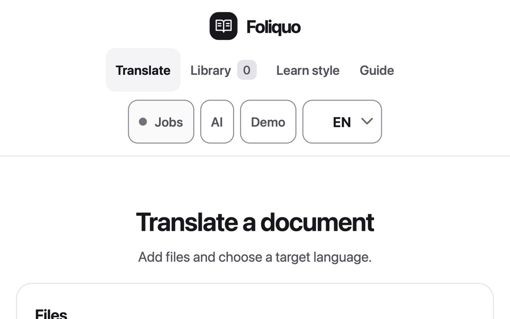

# TranslateOCR

Lokales Übersetzungsstudio für Bilder, PDFs und Word-Dokumente. Mehrere Dateien bilden einen Auftrag, beispielsweise Vorder- und Rückseite einer Urkunde. Die Anwendung unterstützt die fachliche Prüfung und anschließende Beglaubigung durch einen befugten Übersetzer.

Stand: **0.8.3**. TranslateOCR ist Open Source unter MIT-Lizenz; die Demo verwendet ausschließlich fiktive Beispieldaten.



## Download für Windows, macOS und Linux

Öffne die [aktuellen GitHub-Releases](https://github.com/gitmaximilian/TranslateOCR/releases/latest) und lade den Installer für dein Betriebssystem: Windows `.exe`, macOS `.dmg` oder Linux `.deb`/`.rpm`. Installieren und TranslateOCR über das App-Symbol starten. Dafür braucht man weder Node.js noch Terminal oder Browser.

macOS und Windows können bei unsignierten Apps eine Sicherheitsmeldung anzeigen. Siehe [Desktop-Installer und Status](docs/INSTALLABLE-APP.md).

## Entwicklung starten

Node.js ab 22 und LibreOffice werden benötigt. Die Oberfläche und der Dienst laufen auf `http://127.0.0.1:4318/`.

```sh
npm ci --ignore-scripts
npm start
```

Für die Entwicklung im nativen Desktopfenster: `npm run desktop:dev`. Den Paketbau pro Betriebssystem startet `npm run desktop:build`; er erzeugt einen Installer für das aktuelle Betriebssystem. Diese Befehle sind nur für Entwickler. Die bisherigen CMD- und macOS-Skripte bleiben als lokaler Entwicklungs-/Übergangsweg erhalten.

Die öffentlichen Installer werden automatisiert für Windows, macOS ARM64/Intel und Linux gebaut. Mobile Nutzung und öffentliches Hosting sind nicht Teil des aktuellen Ziels. Siehe [Desktop-Installer](docs/INSTALLABLE-APP.md).

ChatGPT lässt sich persönlich über den Browser autorisieren. Alternativ kannst du API-Schlüssel für OpenAI, Claude oder DeepSeek lokal hinterlegen. API-Nutzung kann beim jeweiligen Anbieter separat verrechnet werden. Details zu Zugriff und Datenschutz: [Modellanbieter](docs/PROVIDERS.md). „Demo ohne Konto“ verwendet feste fiktive Daten und führt keine Modellanfrage aus.

## Oberfläche

Die Oberfläche ist auf Englisch voreingestellt und kann im Intro oder später auf Deutsch oder Arabisch umgestellt werden. Arabische Ansichten unterstützen die Schreibrichtung von rechts nach links; das TranslateOCR-Wortzeichen bleibt in seiner korrekten Leserichtung. Beim ersten Start führt eine kurze animierte Tour durch den Ablauf und speichert bevorzugte Sprache und Namen lokal.

## Workflow

1. Dateien in gewünschter Reihenfolge auswählen; Zielsprache und optional Vorlage/Ausgabeprofil festlegen.
2. Zusatzinfos eingeben. Freigegebene Beispiele nur bewusst für diesen Auftrag aktivieren.
3. Übersetzen. Fehlende Angaben beantworten und gegebenenfalls bessere Aufnahmen ergänzen.
4. Original und Übersetzung prüfen; alle Prüfpunkte bestätigen.
5. Werte direkt korrigieren oder Änderungen im Chat anfordern; bestätigte Angaben bei Bedarf schützen. Vorschläge einzeln übernehmen oder frühere Fassungen wiederherstellen.
6. Finale PDF, bearbeitbares Word oder beide als ZIP herunterladen.

Eine automatische Anfangsausgabe wird nicht ungefragt heruntergeladen. Die endgültige fachliche Kontrolle bleibt beim Benutzer. Automatische Prüffelder und Bildkoordinaten sind Hilfen und können falsch oder unvollständig sein. Die separate Erfassung der Originalfelder erhöht die Modellnutzung.

Dossiers bündeln zusammengehörige Aufträge und bestätigte Schreibweisen. Scan-Arbeitskopien, feste Formularfelder, gezielte Referenzauswahl und separate Stempelprüfung unterstützen die Kontrolle. Vor dem finalen Download PDF-Seitenprüfung und Sichtprüfung durchführen.

## Private Bibliothek

- DOCX-Dateien als editierbaren Layoutvorschlag importieren, Vorschau prüfen und bestätigen.
- Persönliche Ausgabeprofile mit Kopf-/Fußzeile und optionalem eigenem Beglaubigungstext.
- Globale Fachbegriffe und auftragsbezogene Namensschreibweisen.
- Ausdrücklich freigegebene Original-/Übersetzungspaare als Referenzsammlung; kein Modelltraining.
- Verschlüsselte Aufträge und Chats mit Löschfrist sowie passwortgeschützten Backups.

Persönliche Dokumente, Beispiele und Kontodaten liegen unter `.local/` und gehören weder in Git noch in Releasepakete. Bei echten Übersetzungen werden die aktuellen Dokumente und die gewählten Referenzen an den Modellanbieter übermittelt. Der lokale Betrieb bedeutet keine vollständig lokale Modellverarbeitung.

## Neue Werkzeuge in 0.8

- Vor der Übersetzung gezielte Rückfragen zu lateinischer Namensschreibweise und unleserlichen Stellen; Antworten bleiben dem Auftrag zugeordnet.
- Originalfelder mit markierten Übersetzungsstellen abgleichen, sowie ein einzelnes Feld anhand der passenden Originalseite erneut vorschlagen lassen.
- Gleiche Dateien erkennen, Vorder-/Rückseite kennzeichnen und PDF-Seiten in einer Arbeitskopie neu ordnen. Originalseiten im Anhang bleiben unverändert.
- Layout live als PDF prüfen, Spaltenbreite und Absatzabstand einstellen und Tabellenzeilen zusammenhalten.
- Wiederholte allgemeine Korrekturen nur als Vorschläge anzeigen; eine Glossarübernahme braucht eine bewusste Bestätigung. Namen, Daten und Nummern werden dabei ausgeschlossen.
- Fiktive Praxis-Testprotokolle und ein lokaler Abnahmebericht unterstützen die Prüfung. Sie bewerten keine Übersetzungsqualität; ein Übersetzer muss zehn repräsentative Fälle selbst beurteilen.
- Die separate `/demo/`-Seite ist auf Deutsch, Englisch und Arabisch verfügbar. Sie zeigt einen geskripteten Beispielablauf mit fiktiven, sprachgerechten Dokumenten und passenden PDF-/Word-Downloads. Sie ruft kein Modell auf.

Das Windows-Paket und die Abnahmeanleitung sind aktualisiert. Der Code wurde hier auf macOS geprüft; die Windows-Installation muss noch auf dem tatsächlichen Ziel-PC abgenommen werden. Der öffentliche Quellcode steht unter MIT-Lizenz. Drittanbieter behalten ihre eigenen Lizenzen; insbesondere enthält das gebündelte LibreOffice-Paket eigene Lizenz- und NOTICE-Dateien. Für Grenzen und fachliche Kontrolle siehe [SECURITY.md](SECURITY.md) und [FEATURES.md](FEATURES.md).

## Entwicklung

```sh
npm run setup
npm test
npm run benchmark
npm run acceptance
node scripts/check-install.mjs
node scripts/package-windows.mjs
npm run demo:build
```

Das Windows-Paket wird aus einer Positivliste erzeugt. Es enthält keine `.local/`, Git-/Hosting-Metadaten, Abhängigkeiten oder persönlichen Dokumente. Die Adapter in `lib/providers.mjs` unterstützen ChatGPT-Anmeldung, OpenAI API, Claude und DeepSeek. Zugangsdaten liegen verschlüsselt im lokalen Workspace und werden aus Backups ausgelassen. Neue Adapter benötigen eigene Anbieter-, Datenschutz- und Fehlerbehandlungstests.

Detaillierte Funktion und Grenzen: [FEATURES.md](FEATURES.md). Architektur und Arbeitsanweisungen: [CODEX-HANDOVER.md](CODEX-HANDOVER.md) und [AGENTS.md](AGENTS.md).

PDF.js samt Lizenzhinweisen liegt unter `dist/vendor/pdfjs/`. Die Lizenzangaben der npm-Abhängigkeiten stehen in `package-lock.json` und in den jeweils mitgelieferten Paketdateien. LibreOffice wird mit seinen eigenen `LICENSE`- und `NOTICE`-Dateien gebündelt. Der MIT-Text gilt nur für TranslateOCR-eigene Beiträge.

Mitarbeit, fiktive Benchmarks und Grenzen der CI: [CONTRIBUTING.md](CONTRIBUTING.md).
