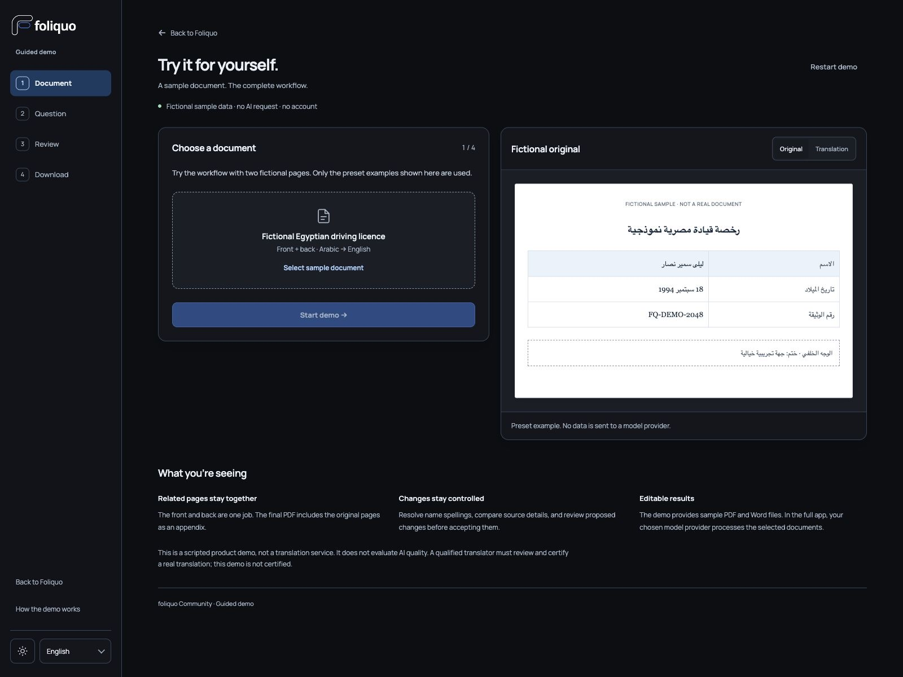
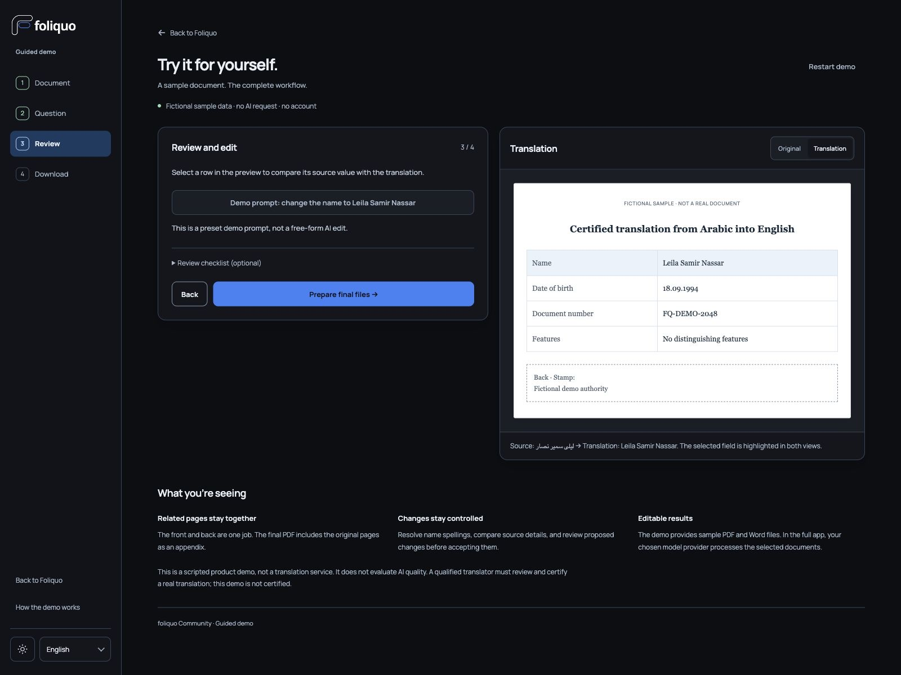

<p align="center">
  <a href="https://maximilianauer.at/projects/foliquo/demo/?lang=en">
    
  </a>
</p>

<p align="center">
  <strong>From document to editable translation.</strong><br>
  Foliquo Community is the free local workspace for noncommercial use covered by its license.<br>
  Choose the browser workspace or a native desktop app for macOS, Windows, or Linux.
</p>

<p align="center">
  <a href="https://maximilianauer.at/projects/foliquo/demo/?lang=en"><strong>Try the demo</strong></a> ·
  <a href="https://github.com/gitmaximilian/Foliquo/releases/tag/desktop-v0.11.7"><strong>Desktop app downloads</strong></a> ·
  <a href="docs/DESKTOP-APPS.md">Desktop setup guide</a> ·
  <a href="https://github.com/gitmaximilian/Foliquo/releases"><strong>Stable browser/CLI downloads</strong></a> ·
  <a href="https://maximilianauer.at/projects/foliquo/">Project story</a>
</p>

<p align="center">
  <a href="https://github.com/gitmaximilian/Foliquo/actions/workflows/ci.yml"></a>
  <a href="LICENSE"></a>
  
</p>

## See the workflow

[](https://maximilianauer.at/projects/foliquo/demo/?lang=en)

**Upload → clarify → refine → download.** Combine the front and back of a document, confirm an uncertain reading, then export PDF and editable Word. Optional review tools stay out of the way until you need them.

The [interactive demo](https://maximilianauer.at/projects/foliquo/demo/?lang=en) walks through all four steps with a fictional driving licence. No account, installation or model request is needed. It includes downloadable PDF and Word examples, and supports English, German and Arabic.

## Made for document work

| One coherent workflow | What it does |
| --- | --- |
| **Add every page** | Images, PDFs and Word files can be grouped into one job. Source language and document type are detected automatically. |
| **Resolve uncertainty** | Accept a suggested spelling, answer a question, or explicitly mark a field unreadable. View the highlighted original with zoom and pan. |
| **Keep moving** | A job queue shows progress and requests for answers. Partial answers and revisions stay saved locally. |
| **Make it your own** | Upload finished translation examples to reuse layout and wording conventions. This supplies reference rules; it does not train model weights. |
| **Refine the result** | Compare original and translation, make direct edits or request changes in a revision chat. Download PDF and Word directly. |
| **Choose your provider** | ChatGPT account authorization, or separately billed OpenAI, Claude and DeepSeek APIs. Connect during onboarding or from the header. |

<details>
<summary><strong>A closer look at source review</strong></summary>



Wheel or trackpad zoom, drag-to-pan, fit-to-view, keyboard controls and a larger view keep small print accessible. The highlight scales with the image, and the view survives unchanged job polling.

</details>

## Download and start

Foliquo opens a local browser-based workspace. It listens only on `127.0.0.1`; keep its console open while working.

**Desktop apps:** Free Windows, macOS (Apple Silicon and Intel), and Linux x64 packages are published on the [0.11.7 GitHub release](https://github.com/gitmaximilian/Foliquo/releases/tag/desktop-v0.11.7), with a [platform install guide](docs/DESKTOP-APPS.md). The Windows installer and macOS apps are unsigned and can show operating-system warnings; Linux is a local Flatpak bundle, not a Flathub listing. The release also includes an unsigned MSIX Store-intake candidate. It is not a direct-install package: its identity must match the app’s Partner Center identity, and Microsoft must sign a Store build before end-user installation.

**Stable browser/CLI distribution:** [The latest published version](https://github.com/gitmaximilian/Foliquo/releases/latest) has verified platform downloads and checksums. The [official Homebrew tap](https://github.com/gitmaximilian/homebrew-tap) is available. Foliquo is not yet available through WinGet; [the Microsoft submission](https://github.com/microsoft/winget-pkgs/pull/462448) is under review.

| Platform | Installation and use |
| --- | --- |
| **macOS 15+, Apple Silicon / Intel** | Download the matching DMG from the desktop release. The app bundles Node and LibreOffice Writer. It is unsigned and not notarized; Gatekeeper may require a one-time approval. |
| **Windows 10/11 x64** | Download the per-user desktop installer. It includes Node, LibreOffice Writer, and WebView2 offline setup. It is unsigned and may show SmartScreen. The separate unsigned MSIX Store-intake candidate is not for direct installation and must be matched to the Partner Center identity before submission. |
| **Linux x64** | Install the Flatpak bundle from the desktop release. It includes Node and LibreOffice Writer and uses the GNOME 50 runtime; see the guide for the install command. |

Read [the desktop apps guide](docs/DESKTOP-APPS.md) for package install and platform-specific first-launch notes. For browser/CLI packages, run `foliquo doctor` to verify PDF/Word export, `foliquo stop` to stop the service and `foliquo data-dir` to locate your private workspace. Browser startup never downloads application code.

### Data, updates and uninstall

Private data is stored separately: `~/Library/Application Support/Foliquo` on macOS, `%LOCALAPPDATA%\Foliquo` on Windows, and `$XDG_DATA_HOME/foliquo` (normally `~/.local/share/foliquo`) on Linux. Upgrades and uninstallers preserve it. Legacy `.local` folders are retained as recovery copies; follow the [verified migration instructions](docs/BROWSER-SETUP.md#private-data-and-migration) before removing an old installation.

The in-app update check links to the release page and sends no documents, settings or credentials to GitHub. Use your platform's update method. For uninstall, use `brew uninstall foliquo`, Windows Installed apps, or remove Linux's application directory and CLI symlink as described in the [setup guide](docs/BROWSER-SETUP.md).

## Local workspace, clear boundaries

Jobs, preferences and provider credentials are stored in the encrypted local workspace. The service binds to `127.0.0.1`. When you request translation or another model-assisted action, your selected provider receives the required document content. Provider usage and subscription limits still apply.

**Foliquo prepares drafts.** A qualified translator must review and certify a document where certification is required. AI can misread or omit information; the public demo illustrates the workflow, not translation accuracy. See [features and limitations](FEATURES.md) and [security notes](SECURITY.md).

## Requirements

- Windows 10 1809+/11 x64, macOS 15+ (packaged builds), or Linux x64 with glibc 2.35+.
- Desktop app release bundle the official pinned Node.js 24 runtime and LibreOffice Writer. Browser/CLI packages need Node.js 22+ and LibreOffice Writer installed separately.
- A modern browser. Keep the launcher terminal open while using the site.

## Developer checks

```sh
npm ci --ignore-scripts
npm test
npm run benchmark
npm run acceptance
npm run demo:build
```

See the [browser setup guide](docs/BROWSER-SETUP.md), [Features and limitations](FEATURES.md), [security notes](SECURITY.md), and [contributing](CONTRIBUTING.md).
