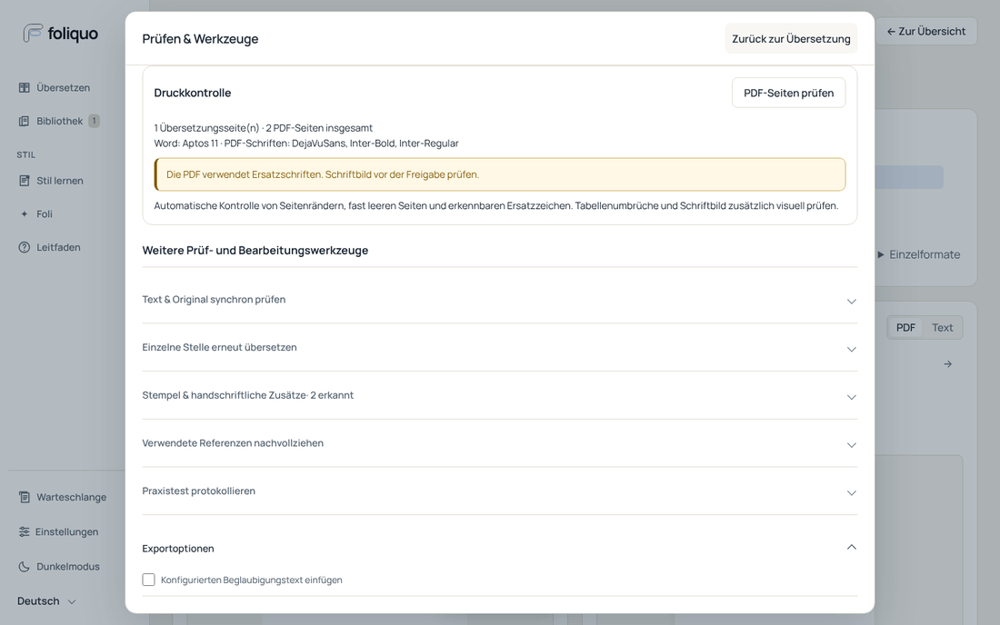
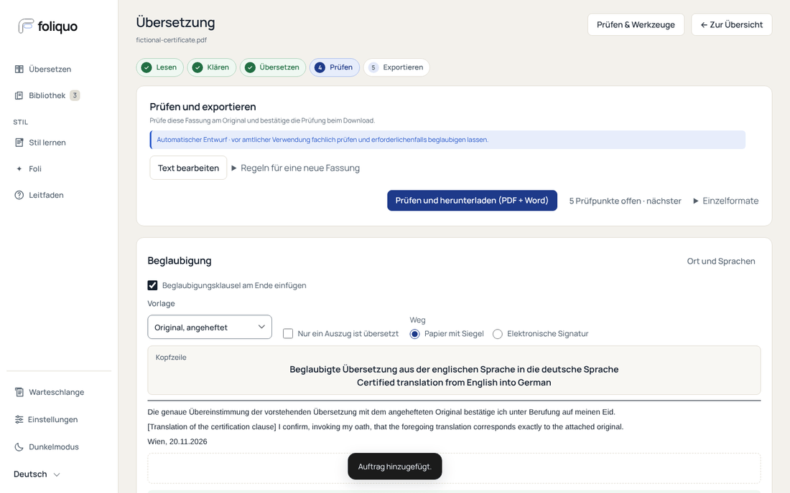
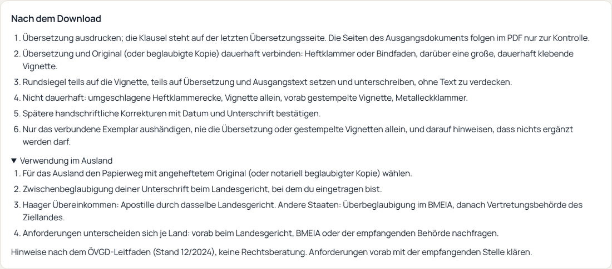
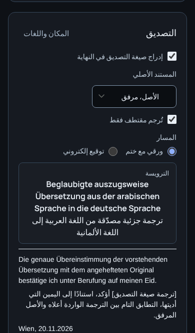
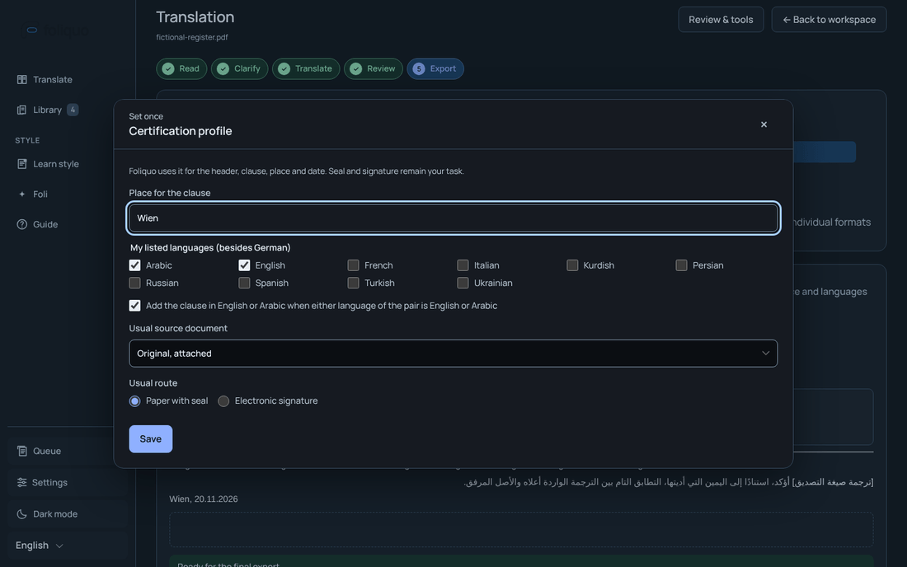

# Simplification review: certified translations — 20 November 2026

Goal: with Foliquo a certified translator goes from document to reviewed, printable or signable translation that follows the ÖVGD guideline "Richtlinien für die richtige Herstellung von gerichtlich zertifizierten Übersetzungen" (12 December 2024), with as few decisions as possible. The requirement-by-requirement mapping is in [CERTIFICATION-GUIDE-MAPPING.md](CERTIFICATION-GUIDE-MAPPING.md).

## Method and evidence boundary

- Baseline: `main` at `f9f9314` (0.16.1). Branch: `claude/foliquo-handover-daten-2q9d04`.
- Chromium walkthrough with a local fixture provider and fictional documents only. No live provider requests.
- Scenarios:
  - Birth certificate as a photo, Arabic → German, with stamp and signature.
  - Two-page PDF decision with stamp and two signatures, German → English.
  - School certificate with a grade table, English → German.
  - Register excerpt (partial translation), Arabic → German.
- The certification panel and checklist were checked in German, English and Arabic, light and dark, at 1440 px and on an iPhone 13 viewport, with axe-core (WCAG 2.0/2.1 A and AA). Visible text, `aria-label`, `title` and `placeholder` in English and Arabic were scanned for German leftovers.
- The exported Word and PDF files were checked automatically in `tests/certification.test.mjs`, `tests/browser/certification-export.spec.mjs` and the walkthrough script: header, clause wording, clause at the end, bilingual version, place and date, and source pages after the translation.
- Not covered: Firefox and WebKit, a screen-reader session, a real printer and a real ID Austria signature.

Findings are **Verified** (reproduced in the walkthrough or a test) or **Suspected** (follows from code reading).

## Findings

| ID | Severity | Finding | Evidence | Change |
| --- | --- | --- | --- | --- |
| S1 | Critical | **Verified.** Foliquo could not produce the certification clause the guideline requires (B 2–3). The only control was an unchecked box, "Konfigurierten Beglaubigungstext einfügen", inside "Prüfen & Werkzeuge → Exportoptionen". No screen could set that text, so the box inserted nothing. | Screenshot below; `layout.certification` is cleared by every template import (`lib/learning.mjs`). | Certification profile plus a visible certification panel on the review page. The clause is generated from the fixed § 190 AußStrG wording and placed at the end of the text (see S2–S4). |
| S2 | High | **Verified.** The header read "Beglaubigte Übersetzung aus dem Arabischen ins Deutsche". It was bilingual only for Arabic → German; English targets had no German line. | `translationTitle` in 0.16.1. | Guide wording "Beglaubigte Übersetzung aus der … Sprache in die … Sprache", plus a line in the other language for English, Arabic, French, Spanish, Italian and Turkish (D 4). |
| S3 | High | **Verified.** A partial translation could not be marked as such (D 4). | — | "Nur ein Auszug ist übersetzt" switches both header lines to "auszugsweise" / "partial". |
| S4 | High | **Verified.** There was no space or marker for seal and signature, and no rule voiding blank space before the clause (B 3, C 3). | — | Rule after the last text block, clause, place and date, then a reserved 5 cm area, kept together on one page. |
| S5 | Medium | **Verified.** Nothing warned about pairs the translator is not listed for, relay pairs, blank runs or signatures missing from the text (D 3, D 5, D 9). | — | Checks in the panel, computed on the server from the same text the export uses. |
| S6 | Medium | **Verified.** What to do after the download was not explained: connection, seal, e-signature limits, legalisation abroad (C 5, E, F, G). | — | Route-specific checklist after download. It names acceptable and unacceptable connections and the electronic-signature limits, and gives the abroad route as information, not legal advice. |
| S7 | Medium | **Verified.** After a finished job, the studio kept showing that job; uploading the next document took an extra click on "Weitere Dokumente übersetzen" in every scenario. | Walkthrough: 3 extra clicks across four documents. | Once a finished job has been opened for review it stays on the desk, and the studio returns to the upload. |
| S8 | Medium | **Verified.** The old desktop app reported a newer workspace as "konnte nicht entschlüsselt werden", which hid the real cause. | Reproduced with a fictional schema-2 workspace and the 0.13-era code. | Separate messages for decryption, format, structure and newer version; the desktop window shows the service's own reason. A newer workspace is never replaced by an older recovery point. |
| S9 | Low | **Verified.** The route radio buttons inherited text-input styling and covered their labels. | Walkthrough screenshot. | Scoped radio styling in the certification panel. |
| S10 | Low | **Suspected.** Many professional settings (practice log, references, rules) sit in the same tools dialog as review-critical items. | Code reading, before screenshot. | Not changed: they are already folded. The certification controls moved out of that dialog. |

## Plan, by effect on simplicity and risk

1. **Done.** Make the clause, header and seal space automatic once a profile exists (S1–S4). This had the largest effect and was low risk, because Foliquo only places fixed wording and never seals, signs or certifies.
2. **Done.** Keep the choice per document to what the guideline distinguishes: source form, excerpt and route. Defaults come from the profile, so the normal case needs no decision.
3. **Done.** Run checks before export and show a checklist after it (S5, S6).
4. **Done.** Return to the upload after reviewing a finished job (S7).
5. **Done.** Honest errors when a workspace cannot be opened (S8).
6. **Not done, and why.** Asking at upload time "original or copy, full or excerpt, paper or electronic" was evaluated and rejected. These answers only affect the export, and asking at upload would add three decisions to every job. They now sit at the export with profile defaults.
7. **Not done.** Foreign clause versions for French, Spanish, Italian and Turkish. Foliquo does not ship legal wording it cannot verify; the panel shows German only for those pairs.

## Before and after

Clicks and inputs from the studio to the downloaded, certified bundle (fixture provider, profile already set, German interface). Selecting a non-default language counts as two clicks.

| Scenario | 0.16.1 | This branch |
| --- | --- | --- |
| Arabic → German birth certificate (first document, includes one-time profile setup) | Not possible: no clause, wrong header wording | 13, including 5 one-time profile inputs; 8 per document afterwards |
| German → English two-page decision | Not possible | 10 |
| English → German certificate with table | Not possible | 8 |
| Arabic → German excerpt | Not possible | 9 (one click for "excerpt") |

In 0.16.1 the clause, the excerpt header and the seal space had to be added by hand in Word after export. That meant a second tool, retyping the clause and redoing the layout for every document.

Before (0.16.1), the only certification control was an inactive option inside the tools dialog:

After, the review page shows the header and clause exactly as exported, with the profile defaults applied:

The checklist after download (paper route, abroad section open):

Phone, Arabic, dark mode. The German clause stays German, and the Arabic version is labelled as a translation:

One-time profile, English interface:

## Results

- axe-core: 0 violations in all 15 checked states: the review page in 3 languages × light/dark × desktop/phone, and the profile dialog in 3 languages.
- English and Arabic interfaces: no German text in the panel, checklist or profile dialog. The scan's only hits were the proper name "ÖVGD". The German header and clause stay German by design, and the foreign versions are labelled.
- Export checks: in all four scenarios the clause is the last text of the translation, place and date follow it, the bilingual version is present for English and Arabic pairs, and the source pages follow the translation in the PDF.

## Remaining limits

- Foliquo checks wording and placement. It cannot check whether the translator is actually listed for a language, whether a seal meets C (1), or how the documents are physically connected.
- The checklist states the guideline's steps as information. Requirements of receiving authorities differ; the panel says to confirm them first.
- Fees for apostille and intermediate certification are not shown, because they change.
